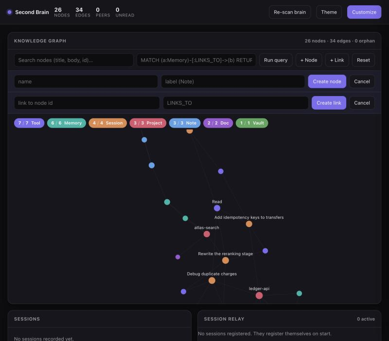
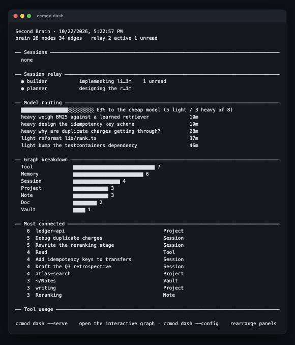
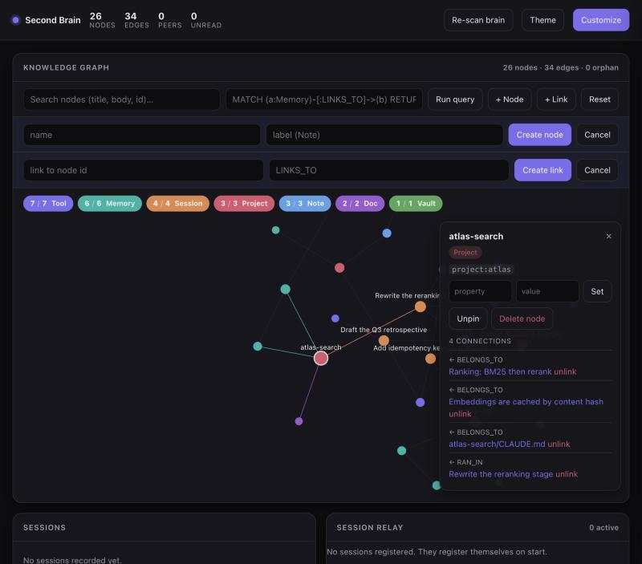
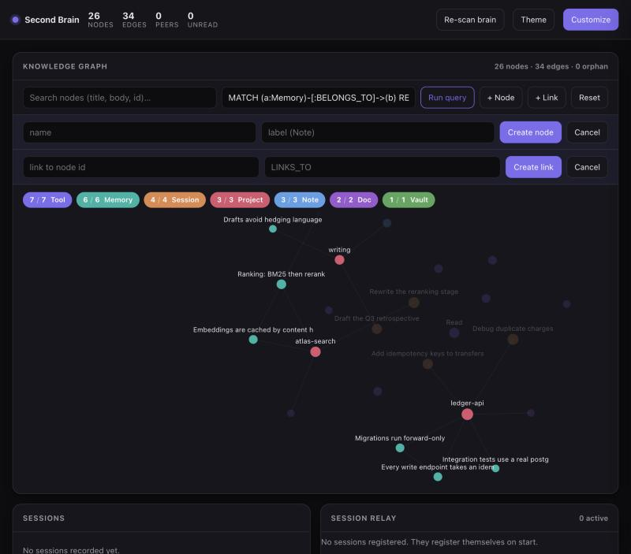

# Second Brain OS

[](https://github.com/shaashwatmishra203-creator/second-brain-os/actions/workflows/ci.yml)
[](LICENSE)
[](https://nodejs.org)

Claude Code already knows a lot about your work — every memory it has written,
every `CLAUDE.md`, every session you have run. It just has no way to show you
any of it, and no way for two sessions to tell each other anything.

This builds a knowledge graph out of all of it and gives you three ways in: a
**CLI**, a **Claude Code mod** that draws it beside the chat, and a **web
explorer** in the shape of a graph browser.

Three pieces, which work on their own or together:

| | What it does |
|---|---|
| **Second brain** | A Neo4j-shaped property graph over SQLite, built from your Claude memories, `CLAUDE.md` files, session history and any markdown vault you point it at. Labels, typed directed edges, full-text search, shortest paths, and a practical subset of Cypher. |
| **Session relay** | A file-backed mailbox so separate Claude Code sessions hand work to each other. One session plans, another builds; a handoff wakes an idle session up. |
| **Model routing** | Classifies every prompt with regex — no extra API call, no added latency — and nudges mechanical work onto a cheap-model subagent instead of the expensive one. |

**No dependencies.** Node 22.13+ (where the built-in `node:sqlite` stops needing
a flag), nothing to build, nothing to install from npm. On 22.5–22.12 it runs
under `NODE_OPTIONS=--experimental-sqlite`, and the CLI tells you so rather
than crashing.



<sub>Screenshots use a small demo graph, not real data.</sub>

---

## Install

```bash
git clone https://github.com/shaashwatmishra203-creator/second-brain-os.git ~/.claude/mods
~/.claude/mods/bin/ccmod install      # copies the subagent and skills into ~/.claude
~/.claude/mods/bin/ccmod brain ingest # build the graph from what Claude already knows
~/.claude/mods/bin/ccmod doctor       # check what is wired and what is not
```

Add `~/.claude/mods/bin` to your `PATH` to type `ccmod` instead of the full path:

```bash
echo 'export PATH="$HOME/.claude/mods/bin:$PATH"' >> ~/.zshrc && exec zsh
```

It does not have to live in `~/.claude/mods` — clone it anywhere and the CLI
works from there. Only your **data** is fixed: the graph, relay mail and config
always live in `~/.claude/mods/{data,config}`, so moving the checkout never
loses your graph. If that directory is already taken, clone elsewhere:

```bash
git clone https://github.com/shaashwatmishra203-creator/second-brain-os.git ~/second-brain-os
~/second-brain-os/bin/ccmod install
```

One step is left by hand, because `settings.json` is yours: the three hooks and
the status line. The exact JSON to merge is in [`docs/hooks.md`](docs/hooks.md).
Without them everything still works, you just drive the relay and the router
yourself instead of them running on every prompt.

### The Claude Code mod

```
/plugin marketplace add shaashwatmishra203-creator/second-brain-os
/plugin install second-brain@second-brain-os
```

### Check it

```bash
ccmod doctor     # ✓ wired · optional, using defaults ✗ needs attention
npm test         # 11 end-to-end checks against a throwaway HOME
```

---

## The CLI

```bash
# the graph
ccmod brain ingest                        # (re)build from memories, docs, sessions, vaults
ccmod brain stats                         # labels, relationships, hubs
ccmod brain search "footprint extraction"  # full-text
ccmod brain find --label Memory            # filter by label and props
ccmod brain query 'MATCH (a:Memory)-[:LINKS_TO]->(b) RETURN a,b'
ccmod brain neighbors mem:alpha            # one hop out
ccmod brain path mem:alpha session:a1b2c3   # how two things connect

# write to it by hand
ccmod brain add note:ranking --label Note --title "Ranking rewrite" --body "BM25 first, then rerank"
ccmod brain link note:ranking BELONGS_TO project:search
ccmod brain rm note:ranking
ccmod brain vault ~/Notes                  # index a markdown folder, then re-ingest

# sessions talking to each other
ccmod relay peers                          # which sessions are live
ccmod relay name planner                   # claim a name for this session
ccmod relay role "deciding the schema"
ccmod relay send builder "schema is settled — implement lib/db.ts"
ccmod relay inbox                          # read (and clear) your messages

# cheap-model routing
ccmod route test "fix the typo in README"  # → LIGHT, would delegate to haiku-worker
ccmod route stats | log | config

# the interface
ccmod dash                                 # in the terminal
ccmod dash --serve --open                  # the web explorer
ccmod dash --html out.html                 # self-contained snapshot, no server
```

`ccmod help` lists everything.

`ccmod dash` puts the same picture in the terminal — graph breakdown, the live
relay peers, and what the router has been sending to the cheap model:



---

## The web explorer

```bash
ccmod dash --serve --open
```

Loopback only, on `127.0.0.1:7717`. A force-directed view of the whole graph:

- **Drag** a node to pin it. The position is saved, and every client — the web
  view and the Claude Code pane — opens on the same arrangement.
- **Double-click** a node to expand one hop out, the way a graph browser does.
- **Click** a node for an inspector: rename it, set or remove properties,
  unlink a connection, unpin, or delete it.
- **+ Node** and **+ Link** create them, inline.
- Filter by label with the legend pills, search full-text, or run Cypher.
- Panels are rearrangeable and the layout is saved.

Clicking a node opens the inspector, which edits in place — set a property,
unlink a connection, unpin or delete, with every connection listed and
clickable:



Running Cypher highlights the matches and dims everything else, so a query is
a way of looking rather than a list of rows:



Everything the explorer does is also an HTTP call you can make yourself —
[`docs/api.md`](docs/api.md) is the reference.

---

## The Claude Code mod

Two panes beside the chat and a strip above the prompt.

**`/second-brain`** draws the graph as inline SVG on desktop, a ranked list in
the terminal. Tabs for the graph, a searchable node list, a detail view and
settings. From the detail view you can rename a node, nudge its pinned
position, unpin it or delete it — the same writes the explorer makes.

**`/vitals`** reports context-window fill, session cost, rate-limit windows,
per-turn token splits, and a **delegation log**: every subagent with the model
it actually ran on, which is how you watch the routing work.

Any module can be **pulled out** into a panel of its own, which the surface
stacks as a switchable tab (`ctrl+x tab`).

**Live mode** is a toggle, off by default. On, the pane polls the explorer's
write counter every four seconds and redraws when the graph changes. It costs
no tokens — drawing and HTTP are free — but it needs `ccmod dash --serve`
running. With the server down the pane says so, and manual Refresh still works.

---

## How the graph is built

| Label | What it is | Edges |
|---|---|---|
| `Memory` | a Claude memory file | `BELONGS_TO` → Project, `LINKS_TO` → Memory |
| `Session` | one Claude Code session | `RAN_IN` → Project, `USED` → Tool |
| `Project` | a working directory | |
| `Note` | a file from an indexed vault | `IN_VAULT` → Vault, `LINKS_TO` → Note |
| `Doc` | a `CLAUDE.md` instruction file | |

`[[wikilinks]]` become `LINKS_TO` edges and `#hashtags` become `TAGGED` edges,
so an Obsidian or Logseq vault keeps its structure. Hashtags are read from
**vault notes only** — in generated prose they are nearly all CSS ids and hex
colours rather than tags.

Ingest is idempotent: run it as often as you like, nodes are upserted by id.

---

## Your data stays yours

Nothing leaves your machine. There is no telemetry and no network call except
to `127.0.0.1`.

The graph indexes your own memories, session titles and project paths, so
`data/` and your real `config/*.json` are gitignored and only
`config/*.example.json` ship. If you fork this, check `git status` before you
commit — CI fails the build if a private path is ever tracked.

The web server **binds `127.0.0.1` and has no authentication**, because it is
not meant to leave your machine. Anyone who reaches the port can rewrite your
graph. Don't change the host, don't forward the port, don't put it behind a
proxy.

---

## Layout

```
bin/ccmod            the CLI entry point
lib/graph.mjs        the property graph over node:sqlite
lib/ingest.mjs       memories, CLAUDE.md, sessions and vaults → nodes
lib/relay.mjs        the session mailbox
lib/router.mjs       prompt classification
lib/server.mjs       the loopback HTTP API
lib/hooks.mjs        what settings.json calls
web/                 the graph explorer
mod/                 the Claude Code plugin (31 tests)
skills/              brain · dash · relay · handoff
agents/              the cheap-model subagent
docs/                hooks.md · api.md · images/
test/                CLI tests, run against a throwaway HOME
```

## Licence

MIT — see [LICENSE](LICENSE).
